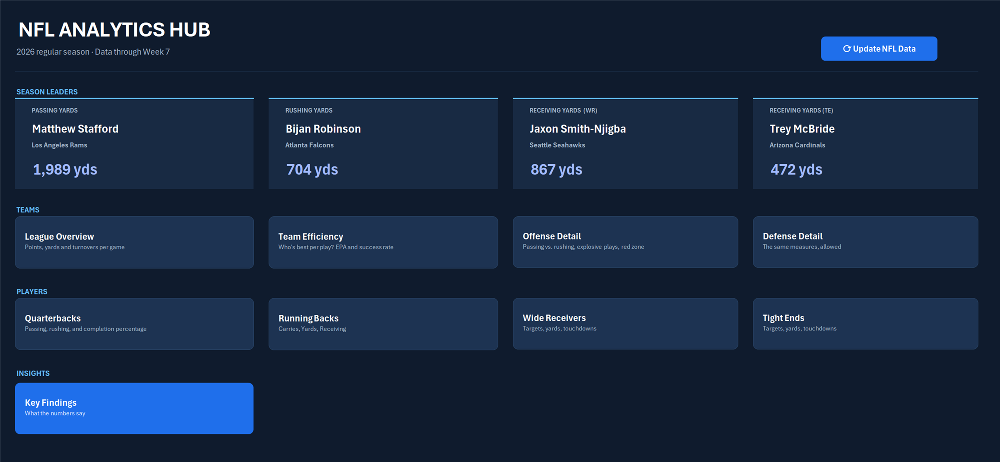
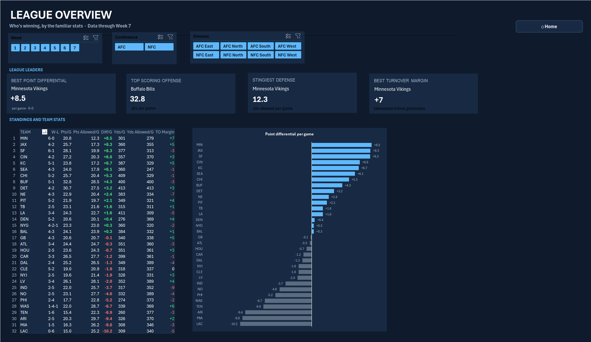
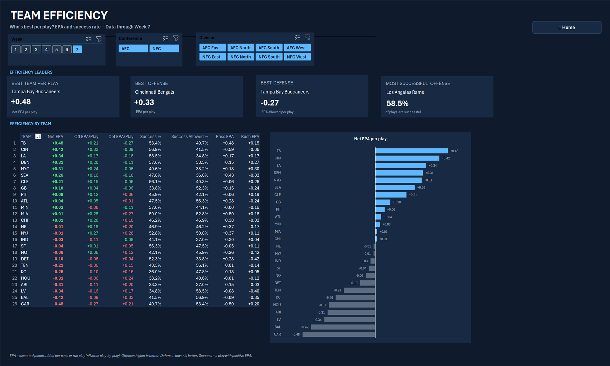
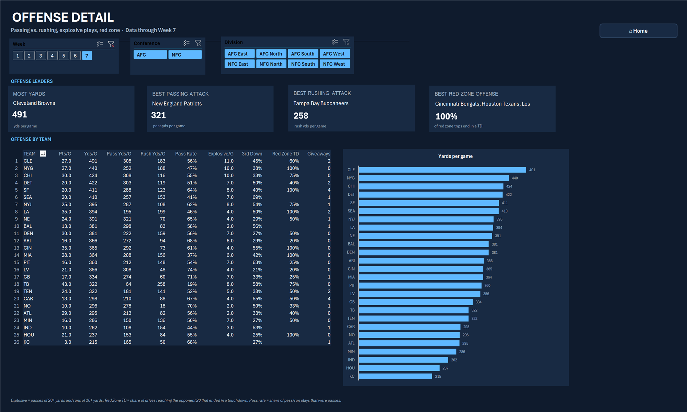
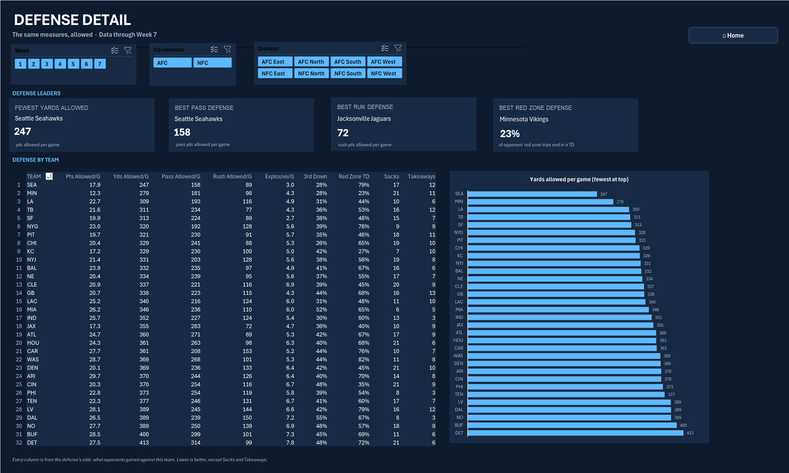
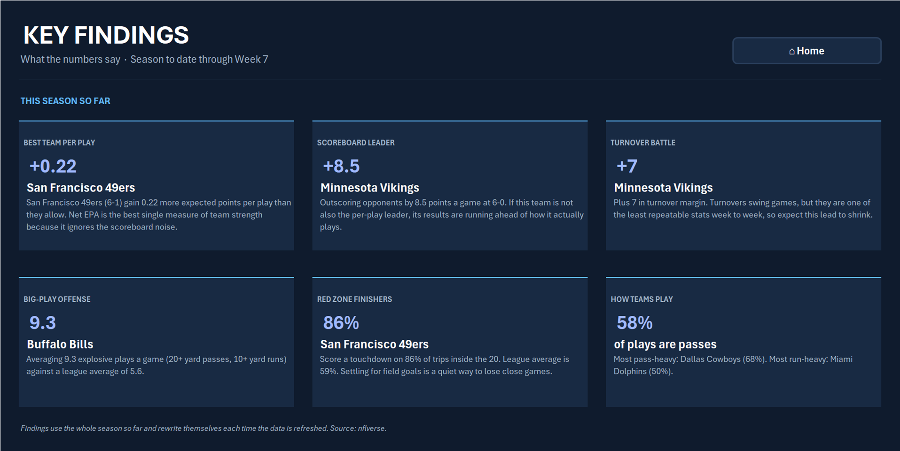
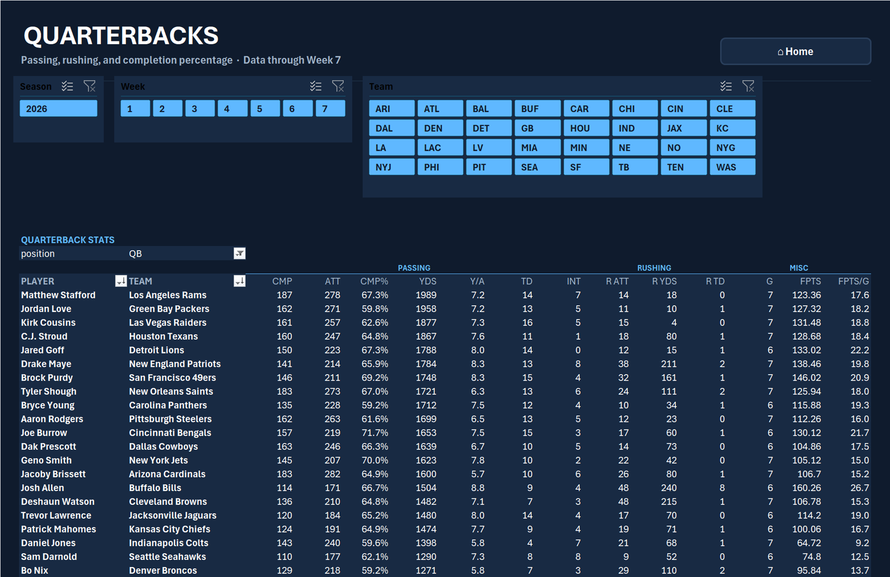

# 2026 NFL Analytics Hub

An interactive Excel dashboard for the 2026 NFL season, built on [nflverse](https://github.com/nflverse/nflverse-data) data. A Python script downloads the latest data, Power Query cleans and reshapes it, Power Pivot measures do the math, and every page filters by week, conference and division. One button in Excel refreshes everything.



## Pages

| Page | What it shows |
| --- | --- |
| **Home Dashboard** | Season leaders (passing, rushing, WR and TE receiving) and links to every page |
| **League Overview** | Standings with W-L, points and yards per game, point differential, turnover margin; leader cards; point differential chart |
| **Team Efficiency** | EPA per play on offense and defense, net EPA, success rate, pass vs. run EPA |
| **Offense Detail** | Passing vs. rushing yards, pass rate, explosive plays, 3rd down rate, red zone TD rate, giveaways |
| **Defense Detail** | The same measures from the defense's side, plus sacks and takeaways |
| **Quarterbacks / Running Backs / Wide Receivers / Tight Ends** | Player stat tables with passing, rushing, receiving and fantasy points |
| **Key Findings** | Six written findings that rewrite themselves from the data on every refresh |

Every team page has slicers for week, conference and division. The table, leader cards and chart on that page all respond to them.

### League Overview


### Team Efficiency


### Offense Detail


### Defense Detail


### Key Findings


### Quarterbacks


*Screenshots show data through Week 7.*

## How it works

1. **`update_nfl_data.py`** downloads the 2026 season files: weekly player and team stats, play-by-play, schedules, snap counts, depth charts, injuries, FTN charting, PFR advanced stats, Next Gen Stats, players and teams. Most come straight from nflverse releases; Next Gen Stats, players and teams come through [`nflreadpy`](https://github.com/nflverse/nflreadpy).
2. **Power Query** loads the CSVs into the Excel data model and reshapes them. For example, the schedule has one row per game, so it's split into a home view and an away view and stacked into `TeamGames`: one row per team per game with points for, points against, result, yards and turnovers for both sides.
3. **Power Pivot** relates everything through `DimTeam`, `DimWeek` and `DimPlayer`, and DAX measures handle the calculations:
   - Per-game stats are measures, not stored columns, so they recalculate for whatever weeks or teams the slicers select (`Pts/G := DIVIDE(SUM(TeamGames[points_for]), [Team Games])`).
   - Defensive versions of play-by-play stats reuse the offensive measures with `USERELATIONSHIP` on the defending team.
   - Leader measures use `TOPN` to return the top team's name and value, and handle ties.
4. **The pages** use pivot tables for the tables and charts, and `CUBEVALUE` formulas tied to each page's slicers for the leader cards.
5. The **`UpdateNFLData`** macro (VBA, button on Home) runs the Python script, waits for it to finish, then refreshes every query and pivot.

## Stat definitions

| Stat | Definition |
| --- | --- |
| EPA per play | Average expected points added on pass and run plays. Offense: higher is better. Defense: lower is better. |
| Net EPA | Offensive EPA per play minus defensive EPA allowed per play |
| Success rate | Share of pass and run plays with positive EPA |
| Explosive play | A pass of 20+ yards or a run of 10+ yards |
| Red zone TD rate | Share of drives reaching the opponent's 20 that ended in a touchdown |
| Pass rate | Share of pass and run plays that were passes |
| Turnover margin | Takeaways (opponent interceptions and lost fumbles) minus giveaways |

## Files

| File | What it is |
| --- | --- |
| `2026 NFL Season.xlsm` | The dashboard: Power Query, data model, measures, pages and the update macro |
| `update_nfl_data.py` | Downloads the raw data CSVs into this folder |
| `requirements.txt` | Python dependency |
| `screenshots/` | Images of the pages used in this README |

The raw CSVs aren't committed because they're large (over 100 MB together) and the script recreates them.

## Run it

```bash
pip install -r requirements.txt
python update_nfl_data.py
```

Then open the `.xlsm` workbook, enable macros, and click **Update NFL Data** on the Home page (or click **Data → Refresh All** after running the script yourself).

The macro and the Power Query sources point to the folder where I keep the project. If you clone it somewhere else, update the script path in the `NFLDataUpdater` module and the query sources under **Data → Queries & Connections**.

## Tools

Python (nflreadpy, urllib) · Excel Power Query · Power Pivot / data model · DAX · Pivot tables and PivotCharts · Slicers · CUBEVALUE · VBA

Data: [nflverse](https://github.com/nflverse), licensed under CC-BY 4.0 by its contributors.
